# 와이어프레임 인벤토리

> 자동 생성 문서 — 피그잼 `용용톤2026_Design` 보드의 `wireframe` 캔버스(2026-11-03 스냅샷)에서
> 레이어 구조를 추출했다. 텍스트는 **레이어 이름**이라 30자 안팎에서 잘린 것이 있다 — 전체 문구는 이미지로 확인.
> 이미지는 1x(390×844) 크롭본. 정본은 피그잼이다.

## 목록

| 코드 | 화면 | 기능 ID / 플로우 |
|---|---|---|
| `hs-s01` | SCREEN 01 • 로그인 | U-02 / F-C0 |
| `hs-s02` | SCREEN 02 • 재학 인증 · 보호자 동의 | U-05 · U-06 · U-08 |
| `hs-s03` | SCREEN 03 • 홈 · AI 탐방 추천 | T-01 · D-01 |
| `hs-s04` | SCREEN 04 • AI 추천 탐방 목록 | T-01 · T-02 |
| `hs-s05` | SCREEN 05 • 탐방 상세 · 신청 | T-02 · A-01 |
| `hs-s06` | SCREEN 06 • 신청 완료 · 승인 대기 | A-01 · A-02 · T-04 |
| `hs-s07` | SCREEN 07 • 내 탐방 · 승인 완료 | A-02 · A-03 · T-04 |
| `hs-s08` | SCREEN 08 • 탐방 코스 지도 | C-04 · S-02 · R-02 |
| `hs-s09` | SCREEN 09 • 상점 쿠폰 · 사용 | S-04 · S-05 · S-06 |
| `hs-s10` | SCREEN 10 • 방문 리뷰 작성 | R-01 · R-02 · R-03 |
| `hs-a01` | ADD 01 • 회원가입 · 역할 선택 | U-01 / F-C0 |
| `hs-a02` | ADD 02 • 보호자 동의 페이지 | U-06 / F-C1 · 외부 링크 |
| `hs-a03` | ADD 03 • 내 정보 · 인증 상태 | U-03 / U-08 · F-C0 |
| `hs-a04` | ADD 04 • 탐방 신청서 | A-01 · 추가 UX 단계 / FigJam 반영 대기 |
| `hs-a05` | ADD 05 • 내 탐방 상태별 목록 | T-04 · A-02 · A-03 / F-H1 |
| `hs-a06` | ADD 06 • 탐방 추천·신청 예외 상태 | T-01 · T-02 · A-01 / F-H1 |
| `guide-s01` | SCREEN 01 • 가이드 프로필 | U-04 · U-05 |
| `guide-s02` | SCREEN 02 • 탐방 개설 | T-03 · D-01 |
| `guide-s03` | SCREEN 03 • 신청자 관리 | A-02 · A-04 · T-05 |
| `guide-s04` | SCREEN 04 • AI 추천 코스 생성 | C-01 · D-03 (정의 확인 필요) |
| `guide-s05` | SCREEN 05 • 코스 편집 · 상점 교체 | C-02 · S-02 |
| `guide-s06` | SCREEN 06 • 코스 확정 · 쿠폰 발급 | C-03 · S-04 |
| `guide-s07` | SCREEN 07 • 탐방 종료 · 완료 | T-06 · R-01 |
| `guide-a01` | ADD 01 • 대학생 재학 인증 | U-05 / F-C1 |
| `guide-a02` | ADD 02 • 내가 개설한 탐방 | T-04 · T-05 / F-G1 |
| `guide-a03` | ADD 03 • 주변 상점 교체 | C-02 · S-02 / F-G2 |
| `guide-a04` | ADD 04 • 탐방 취소 확인 | T-05 / F-G2 · 예외 |
| `owner-s01` | SCREEN 01 • 사업자 인증 | U-07 · S-01 |
| `owner-s02` | SCREEN 02 • 내 가게 · 제휴 할인 | S-01 · S-03 |
| `owner-s03` | SCREEN 03 • 쿠폰 사용 처리 | S-06 |
| `owner-s04` | SCREEN 04 • 방문 · 리뷰 리포트 | S-07 · R-02 · R-03 |
| `owner-s05` | SCREEN 05 • 빈 시간 달력 | S-03 · D-02 검토 / FigJam 미표시 |
| `owner-s06` | SCREEN 06 • 운영자 인증 심사 | U-08 · F-A1 |
| `owner-a01` | ADD 01 • 가게 후보 선택·직접 등록 | S-01 / F-O1 |
| `owner-a02` | ADD 02 • 학생증 상세 심사·반려 | U-08 / F-A1 |
| `owner-a03` | ADD 03 • 쿠폰·리포트 예외 상태 | S-06 · S-07 / 상태 UI |

## 고교생

### `hs-s01` SCREEN 01 • 로그인

- 기능/플로우: U-02 / F-C0
- 보드 라벨: 01 / 로그인
- 피그잼 노드: [1:35](https://www.figma.com/board/VeUqh8ihXdgzUkpMTaPXsr/?node-id=1-35)
- 이미지: 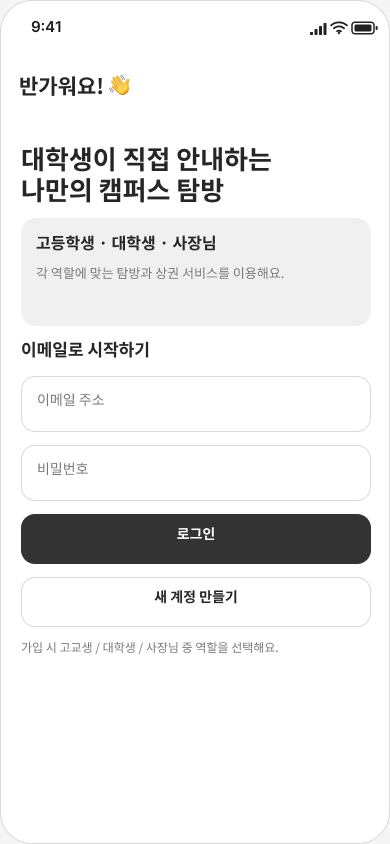

레이어 구조

- **Top bar**
  - "반가워요! 👋"
- **Main content**
  - "대학생이 직접 안내하는 나만의 캠퍼스 탐방"
  - **Intro**
    - "고등학생 · 대학생 · 사장님"
    - "각 역할에 맞는 탐방과 상권 서비스를 이용해요."
  - "이메일로 시작하기"
  - [Field / Input / 350×56]
  - [Field / Input / 350×56]
  - [Button / Primary / 350×50]
  - [Button / Secondary / 350×50]
  - "가입 시 고교생 / 대학생 / 사장님 중 역할을"

### `hs-s02` SCREEN 02 • 재학 인증 · 보호자 동의

- 기능/플로우: U-05 · U-06 · U-08
- 보드 라벨: 02 / 재학 인증 · 보호자 동의
- 피그잼 노드: [1:52](https://www.figma.com/board/VeUqh8ihXdgzUkpMTaPXsr/?node-id=1-52)
- 이미지: 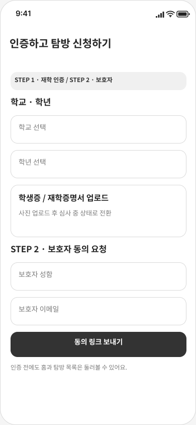

레이어 구조

- **Top bar**
  - "인증하고 탐방 신청하기"
- **Main content**
  - **Chip • STEP 1 · 재학 인증 필요**
    - "STEP 1 · 재학 인증 / STEP 2 · 보호자"
  - "학교 · 학년"
  - [Field / Input / 350×56]
  - [Field / Input / 350×56]
  - **Upload student proof**
    - "학생증 / 재학증명서 업로드"
    - "사진 업로드 후 심사 중 상태로 전환"
  - "STEP 2 · 보호자 동의 요청"
  - [Field / Input / 350×56]
  - [Field / Input / 350×56]
  - [Button / Primary / 350×50]
  - "인증 전에도 홈과 탐방 목록은 둘러볼 수 있어요"

### `hs-s03` SCREEN 03 • 홈 · AI 탐방 추천

- 기능/플로우: T-01 · D-01
- 보드 라벨: 03 / 홈 · AI 탐방 추천
- 피그잼 노드: [1:72](https://www.figma.com/board/VeUqh8ihXdgzUkpMTaPXsr/?node-id=1-72)
- 이미지: 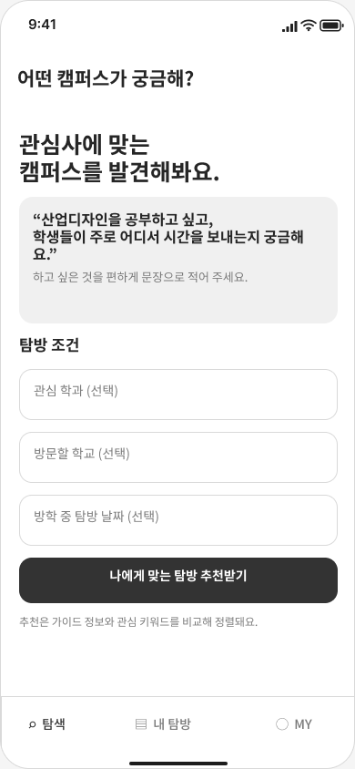

레이어 구조

- **Top bar**
  - "어떤 캠퍼스가 궁금해?"
- **Main content**
  - "관심사에 맞는 캠퍼스를 발견해봐요."
  - **AI conversation starter**
    - "“산업디자인을 공부하고 싶고, 학생들이 주로 어"
    - "하고 싶은 것을 편하게 문장으로 적어 주세요."
  - "탐방 조건"
  - [Field / Input / 350×56]
  - [Field / Input / 350×56]
  - [Field / Input / 350×56]
  - [Button / Primary / 350×50]
  - "추천은 가이드 정보와 관심 키워드를 비교해 정렬"
- **Bottom Navigation**
  - [Navigation / Student Bottom]

### `hs-s04` SCREEN 04 • AI 추천 탐방 목록

- 기능/플로우: T-01 · T-02
- 보드 라벨: 04 / AI 추천 탐방 목록
- 피그잼 노드: [1:91](https://www.figma.com/board/VeUqh8ihXdgzUkpMTaPXsr/?node-id=1-91)
- 이미지: 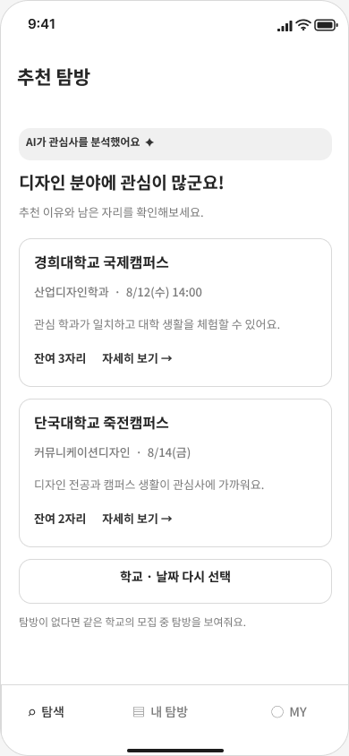

레이어 구조

- **Top bar**
  - "추천 탐방"
- **Main content**
  - **Chip • AI가 관심사를 분석했어요 ✦**
    - "AI가 관심사를 분석했어요 ✦"
  - "디자인 분야에 관심이 많군요!"
  - "추천 이유와 남은 자리를 확인해보세요."
  - [Card / Tour Preview]
  - [Card / Tour Preview]
  - [Button / Secondary / 350×50]
  - "탐방이 없다면 같은 학교의 모집 중 탐방을 보여"
- **Bottom Navigation**
  - [Navigation / Student Bottom]

### `hs-s05` SCREEN 05 • 탐방 상세 · 신청

- 기능/플로우: T-02 · A-01
- 보드 라벨: 05 / 탐방 상세 · 신청
- 피그잼 노드: [1:108](https://www.figma.com/board/VeUqh8ihXdgzUkpMTaPXsr/?node-id=1-108)
- 이미지: 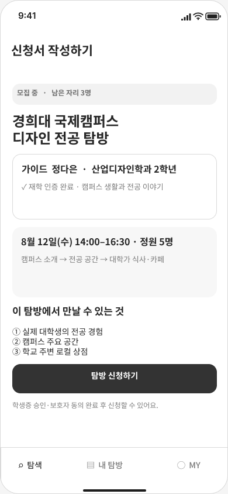

레이어 구조

- **Top bar**
  - "신청서 작성하기"
- **Main content**
  - **Chip • 모집 중 · 남은 자리 3명**
    - "모집 중 · 남은 자리 3명"
  - "경희대 국제캠퍼스 디자인 전공 탐방"
  - **Guide profile**
    - "가이드 정다은 · 산업디자인학과 2학년"
    - "✓ 재학 인증 완료 · 캠퍼스 생활과 전공 이야"
  - **Tour information**
    - "8월 12일(수) 14:00–16:30 · 정원"
    - "캠퍼스 소개 → 전공 공간 → 대학가 식사·카페"
  - "이 탐방에서 만날 수 있는 것"
  - "① 실제 대학생의 전공 경험 ② 캠퍼스 주요 공"
  - [Button / Primary / 350×50]
  - "학생증 승인·보호자 동의 완료 후 신청할 수 있"
- **Bottom Navigation**
  - [Navigation / Student Bottom]

### `hs-s06` SCREEN 06 • 신청 완료 · 승인 대기

- 기능/플로우: A-01 · A-02 · T-04
- 보드 라벨: 06 / 신청 완료 · 승인 대기
- 피그잼 노드: [1:130](https://www.figma.com/board/VeUqh8ihXdgzUkpMTaPXsr/?node-id=1-130)
- 이미지: 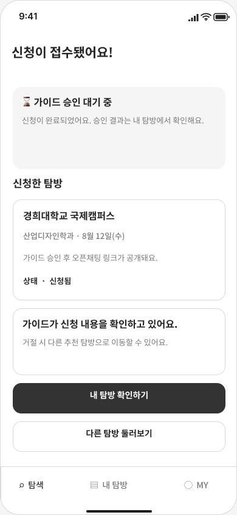

레이어 구조

- **Top bar**
  - "신청이 접수됐어요!"
- **Main content**
  - **Application pending**
    - "⌛ 가이드 승인 대기 중"
    - "신청이 완료되었어요. 승인 결과는 내 탐방에서"
  - "신청한 탐방"
  - [Card / Tour Preview]
  - **Next step**
    - "가이드가 신청 내용을 확인하고 있어요."
    - "거절 시 다른 추천 탐방으로 이동할 수 있어요."
  - [Button / Primary / 350×50]
  - [Button / Secondary / 350×50]
- **Bottom Navigation**
  - [Navigation / Student Bottom]

### `hs-s07` SCREEN 07 • 내 탐방 · 승인 완료

- 기능/플로우: A-02 · A-03 · T-04
- 보드 라벨: 07 / 내 탐방 · 승인 완료
- 피그잼 노드: [1:149](https://www.figma.com/board/VeUqh8ihXdgzUkpMTaPXsr/?node-id=1-149)
- 이미지: 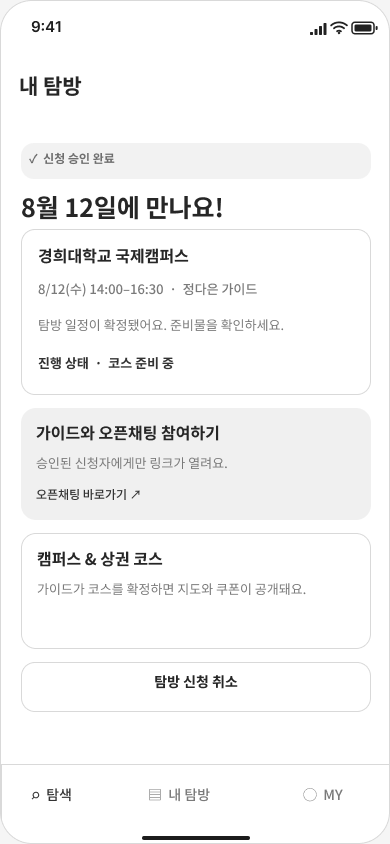

레이어 구조

- **Top bar**
  - "내 탐방"
- **Main content**
  - **Chip • ✓ 신청 승인 완료**
    - "✓ 신청 승인 완료"
  - "8월 12일에 만나요!"
  - [Card / Tour Preview]
  - **Chat link**
    - "가이드와 오픈채팅 참여하기"
    - "승인된 신청자에게만 링크가 열려요."
    - "오픈채팅 바로가기 ↗"
  - **Course status**
    - "캠퍼스 & 상권 코스"
    - "가이드가 코스를 확정하면 지도와 쿠폰이 공개돼요"
  - [Button / Secondary / 350×50]
- **Bottom Navigation**
  - [Navigation / Student Bottom]

### `hs-s08` SCREEN 08 • 탐방 코스 지도

- 기능/플로우: C-04 · S-02 · R-02
- 보드 라벨: 08 / 탐방 코스 지도
- 피그잼 노드: [1:170](https://www.figma.com/board/VeUqh8ihXdgzUkpMTaPXsr/?node-id=1-170)
- 이미지: 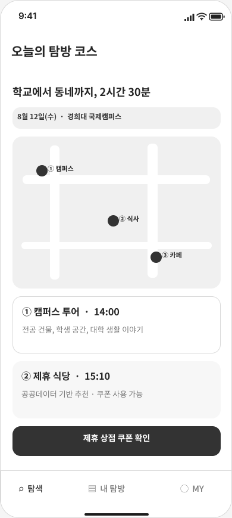

레이어 구조

- **Top bar**
  - "오늘의 탐방 코스"
- **Main content**
  - "학교에서 동네까지, 2시간 30분"
  - **Chip • 8월 12일(수) · 경희대 국제캠퍼스**
    - "8월 12일(수) · 경희대 국제캠퍼스"
  - **Editable map / schematic pins**
    - "① 캠퍼스"
    - "② 식사"
    - "③ 카페"
  - **Stop #1**
    - "① 캠퍼스 투어 · 14:00"
    - "전공 건물, 학생 공간, 대학 생활 이야기"
  - **Stop #2**
    - "② 제휴 식당 · 15:10"
    - "공공데이터 기반 추천 · 쿠폰 사용 가능"
  - [Button / Primary / 350×50]
- **Bottom Navigation**
  - [Navigation / Student Bottom]

### `hs-s09` SCREEN 09 • 상점 쿠폰 · 사용

- 기능/플로우: S-04 · S-05 · S-06
- 보드 라벨: 09 / 상점 쿠폰 · 사용
- 피그잼 노드: [1:200](https://www.figma.com/board/VeUqh8ihXdgzUkpMTaPXsr/?node-id=1-200)
- 이미지: 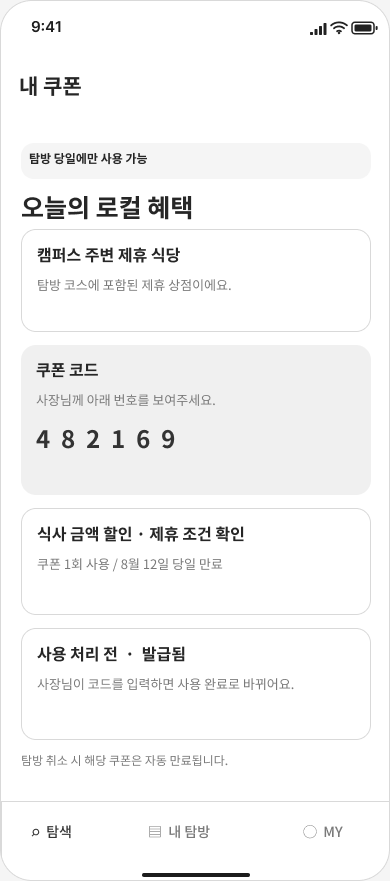

레이어 구조

- **Top bar**
  - "내 쿠폰"
- **Main content**
  - **Chip • 탐방 당일에만 사용 가능**
    - "탐방 당일에만 사용 가능"
  - "오늘의 로컬 혜택"
  - **Partner shop**
    - "캠퍼스 주변 제휴 식당"
    - "탐방 코스에 포함된 제휴 상점이에요."
  - **Redeem code**
    - "쿠폰 코드"
    - "사장님께 아래 번호를 보여주세요."
    - "4 8 2 1 6 9"
  - **Benefit**
    - "식사 금액 할인 · 제휴 조건 확인"
    - "쿠폰 1회 사용 / 8월 12일 당일 만료"
  - **State**
    - "사용 처리 전 · 발급됨"
    - "사장님이 코드를 입력하면 사용 완료로 바뀌어요."
  - "탐방 취소 시 해당 쿠폰은 자동 만료됩니다."
- **Bottom Navigation**
  - [Navigation / Student Bottom]

### `hs-s10` SCREEN 10 • 방문 리뷰 작성

- 기능/플로우: R-01 · R-02 · R-03
- 보드 라벨: 10 / 방문 리뷰 작성
- 피그잼 노드: [1:226](https://www.figma.com/board/VeUqh8ihXdgzUkpMTaPXsr/?node-id=1-226)
- 이미지: 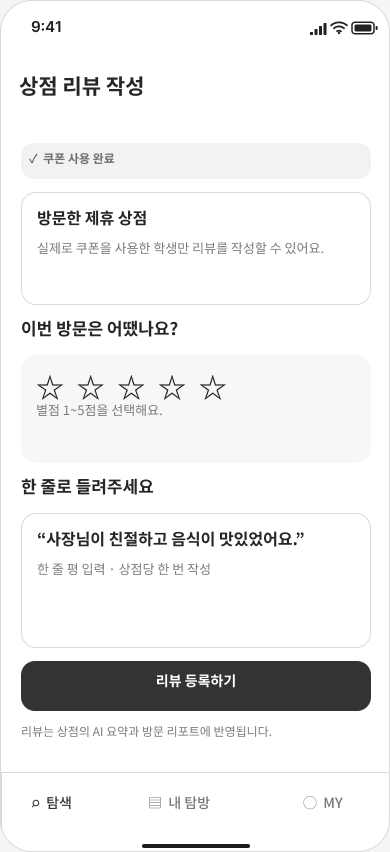

레이어 구조

- **Top bar**
  - "상점 리뷰 작성"
- **Main content**
  - **Chip • ✓ 쿠폰 사용 완료**
    - "✓ 쿠폰 사용 완료"
  - **Review target**
    - "방문한 제휴 상점"
    - "실제로 쿠폰을 사용한 학생만 리뷰를 작성할 수"
  - "이번 방문은 어땠나요?"
  - **Star selector**
    - "☆ ☆ ☆ ☆ ☆"
    - "별점 1~5점을 선택해요."
  - "한 줄로 들려주세요"
  - **Review text box**
    - "“사장님이 친절하고 음식이 맛있었어요.”"
    - "한 줄 평 입력 · 상점당 한 번 작성"
  - [Button / Primary / 350×50]
  - "리뷰는 상점의 AI 요약과 방문 리포트에 반영됩"
- **Bottom Navigation**
  - [Navigation / Student Bottom]

### `hs-a01` ADD 01 • 회원가입 · 역할 선택

- 기능/플로우: U-01 / F-C0
- 보드 라벨: 01 / 회원가입 · 역할 선택
- 피그잼 노드: [1:258](https://www.figma.com/board/VeUqh8ihXdgzUkpMTaPXsr/?node-id=1-258)
- 이미지: 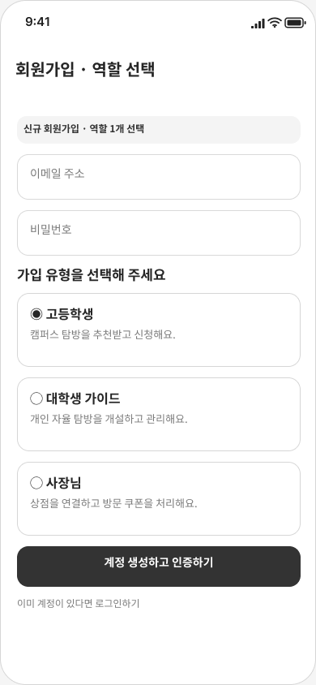

레이어 구조

- **Top bar**
  - "회원가입 · 역할 선택"
- **Main content**
  - **Status / 신규 회원가입 · 역할 1개 선택**
    - "신규 회원가입 · 역할 1개 선택"
  - [input]
  - [input]
  - "가입 유형을 선택해 주세요"
  - **Role 1**
    - "◉ 고등학생"
    - "캠퍼스 탐방을 추천받고 신청해요."
  - **Role 2**
    - "◯ 대학생 가이드"
    - "개인 자율 탐방을 개설하고 관리해요."
  - **Role 3**
    - "◯ 사장님"
    - "상점을 연결하고 방문 쿠폰을 처리해요."
  - [primary]
  - "이미 계정이 있다면 로그인하기"

### `hs-a02` ADD 02 • 보호자 동의 페이지

- 기능/플로우: U-06 / F-C1 · 외부 링크
- 보드 라벨: 02 / 보호자 동의 페이지
- 피그잼 노드: [1:279](https://www.figma.com/board/VeUqh8ihXdgzUkpMTaPXsr/?node-id=1-279)
- 이미지: 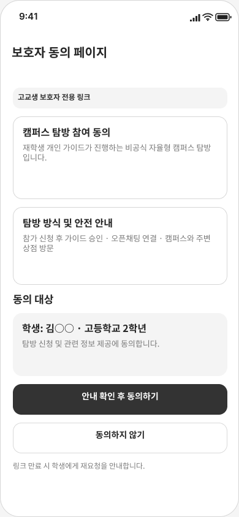

레이어 구조

- **Top bar**
  - "보호자 동의 페이지"
- **Main content**
  - **Status / 고교생 보호자 전용 링크**
    - "고교생 보호자 전용 링크"
  - **Purpose**
    - "캠퍼스 탐방 참여 동의"
    - "재학생 개인 가이드가 진행하는 비공식 자"
  - **Info**
    - "탐방 방식 및 안전 안내"
    - "참가 신청 후 가이드 승인 · 오픈채팅"
  - "동의 대상"
  - **Student**
    - "학생: 김○○ · 고등학교 2학년"
    - "탐방 신청 및 관련 정보 제공에 동의합니"
  - [primary]
  - [secondary]
  - "링크 만료 시 학생에게 재요청을 안내합니"

### `hs-a03` ADD 03 • 내 정보 · 인증 상태

- 기능/플로우: U-03 / U-08 · F-C0
- 보드 라벨: 03 / 내 정보 · 인증 상태
- 피그잼 노드: [1:299](https://www.figma.com/board/VeUqh8ihXdgzUkpMTaPXsr/?node-id=1-299)
- 이미지: 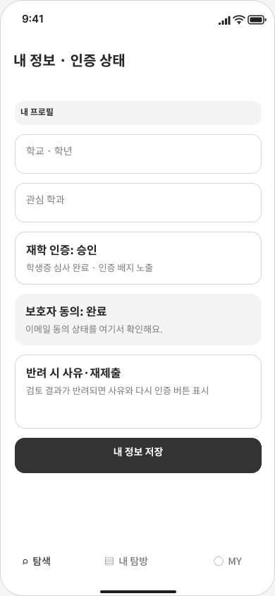

레이어 구조

- **Top bar**
  - "내 정보 · 인증 상태"
- **Main content**
  - **Status / 내 프로필**
    - "내 프로필"
  - [input]
  - [input]
  - **Certification**
    - "재학 인증: 승인"
    - "학생증 심사 완료 · 인증 배지 노출"
  - **Guardian**
    - "보호자 동의: 완료"
    - "이메일 동의 상태를 여기서 확인해요."
  - **Rejected state**
    - "반려 시 사유·재제출"
    - "검토 결과가 반려되면 사유와 다시 인증"
  - [primary]
- **Bottom Navigation**
  - [nav]

### `hs-a04` ADD 04 • 탐방 신청서

- 기능/플로우: A-01 · 추가 UX 단계 / FigJam 반영 대기
- 보드 라벨: 04 / 탐방 신청서
- 피그잼 노드: [1:320](https://www.figma.com/board/VeUqh8ihXdgzUkpMTaPXsr/?node-id=1-320)
- 이미지: 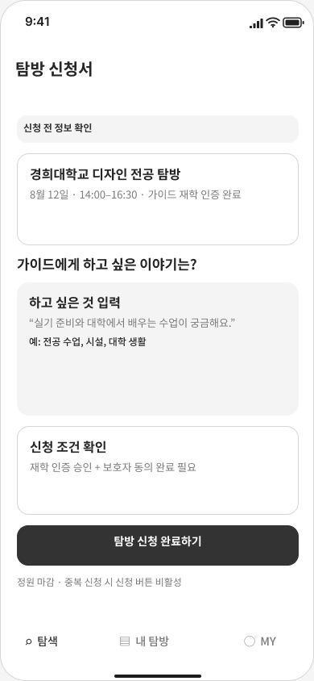

레이어 구조

- **Top bar**
  - "탐방 신청서"
- **Main content**
  - **Status / 신청 전 정보 확인**
    - "신청 전 정보 확인"
  - **Selected tour**
    - "경희대학교 디자인 전공 탐방"
    - "8월 12일 · 14:00–16:30 ·"
  - "가이드에게 하고 싶은 이야기는?"
  - **Textarea / answer**
    - "하고 싶은 것 입력"
    - "“실기 준비와 대학에서 배우는 수업이 궁"
    - "예: 전공 수업, 시설, 대학 생활"
  - **Check eligibility**
    - "신청 조건 확인"
    - "재학 인증 승인 + 보호자 동의 완료 필"
  - [primary]
  - "정원 마감 · 중복 신청 시 신청 버튼"
- **Bottom Navigation**
  - [nav]

### `hs-a05` ADD 05 • 내 탐방 상태별 목록

- 기능/플로우: T-04 · A-02 · A-03 / F-H1
- 보드 라벨: 05 / 내 탐방 상태별 목록
- 피그잼 노드: [1:342](https://www.figma.com/board/VeUqh8ihXdgzUkpMTaPXsr/?node-id=1-342)
- 이미지: 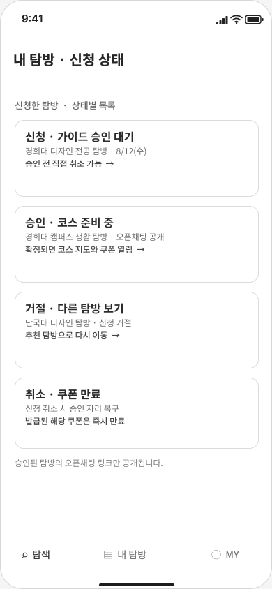

레이어 구조

- **Top bar**
  - "내 탐방 · 신청 상태"
- **Main content**
  - "신청한 탐방 · 상태별 목록"
  - **State / 신청 · 가이드 승인 대기**
    - "신청 · 가이드 승인 대기"
    - "경희대 디자인 전공 탐방 · 8/12(수)"
    - "승인 전 직접 취소 가능 →"
  - **State / 승인 · 코스 준비 중**
    - "승인 · 코스 준비 중"
    - "경희대 캠퍼스 생활 탐방 · 오픈채팅 공개"
    - "확정되면 코스 지도와 쿠폰 열림 →"
  - **State / 거절 · 다른 탐방 보기**
    - "거절 · 다른 탐방 보기"
    - "단국대 디자인 탐방 · 신청 거절"
    - "추천 탐방으로 다시 이동 →"
  - **State / 취소 · 쿠폰 만료**
    - "취소 · 쿠폰 만료"
    - "신청 취소 시 승인 자리 복구"
    - "발급된 해당 쿠폰은 즉시 만료"
  - "승인된 탐방의 오픈채팅 링크만 공개됩니다."
- **Bottom Navigation**
  - [nav]

### `hs-a06` ADD 06 • 탐방 추천·신청 예외 상태

- 기능/플로우: T-01 · T-02 · A-01 / F-H1
- 보드 라벨: 06 / 탐방 추천·신청 예외 상태
- 피그잼 노드: [1:367](https://www.figma.com/board/VeUqh8ihXdgzUkpMTaPXsr/?node-id=1-367)
- 이미지: 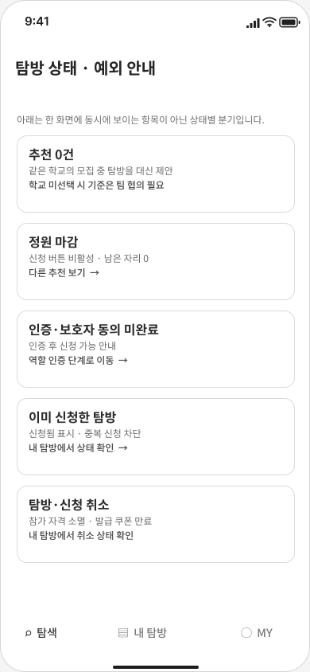

레이어 구조

- **Top bar**
  - "탐방 상태 · 예외 안내"
- **Main content**
  - "아래는 한 화면에 동시에 보이는 항목이 아닌 상태별 분"
  - **State / 추천 0건**
    - "추천 0건"
    - "같은 학교의 모집 중 탐방을 대신 제안"
    - "학교 미선택 시 기준은 팀 협의 필요"
  - **State / 정원 마감**
    - "정원 마감"
    - "신청 버튼 비활성 · 남은 자리 0"
    - "다른 추천 보기 →"
  - **State / 인증·보호자 동의 미완료**
    - "인증·보호자 동의 미완료"
    - "인증 후 신청 가능 안내"
    - "역할 인증 단계로 이동 →"
  - **State / 이미 신청한 탐방**
    - "이미 신청한 탐방"
    - "신청됨 표시 · 중복 신청 차단"
    - "내 탐방에서 상태 확인 →"
  - **State / 탐방·신청 취소**
    - "탐방·신청 취소"
    - "참가 자격 소멸 · 발급 쿠폰 만료"
    - "내 탐방에서 취소 상태 확인"
- **Bottom Navigation**
  - [nav]

## 대학생 가이드

### `guide-s01` SCREEN 01 • 가이드 프로필

- 기능/플로우: U-04 · U-05
- 보드 라벨: 01 / 가이드 프로필
- 피그잼 노드: [1:704](https://www.figma.com/board/VeUqh8ihXdgzUkpMTaPXsr/?node-id=1-704)
- 이미지: 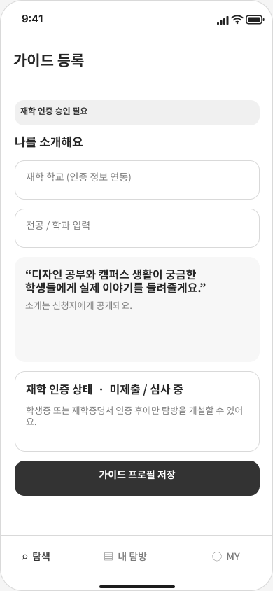

레이어 구조

- **Top bar**
  - "가이드 등록"
- **Main content**
  - **Chip • 재학 인증 승인 필요**
    - "재학 인증 승인 필요"
  - "나를 소개해요"
  - [Field / Input / 350×56]
  - [Field / Input / 350×56]
  - **Profile introduction**
    - "“디자인 공부와 캠퍼스 생활이 궁금한 학생들에게"
    - "소개는 신청자에게 공개돼요."
  - **Authentication**
    - "재학 인증 상태 · 미제출 / 심사 중"
    - "학생증 또는 재학증명서 인증 후에만 탐방을 개설"
  - [Button / Primary / 350×50]
- **Bottom Navigation**
  - [Navigation / Student Bottom]

### `guide-s02` SCREEN 02 • 탐방 개설

- 기능/플로우: T-03 · D-01
- 보드 라벨: 02 / 탐방 개설
- 피그잼 노드: [1:725](https://www.figma.com/board/VeUqh8ihXdgzUkpMTaPXsr/?node-id=1-725)
- 이미지: 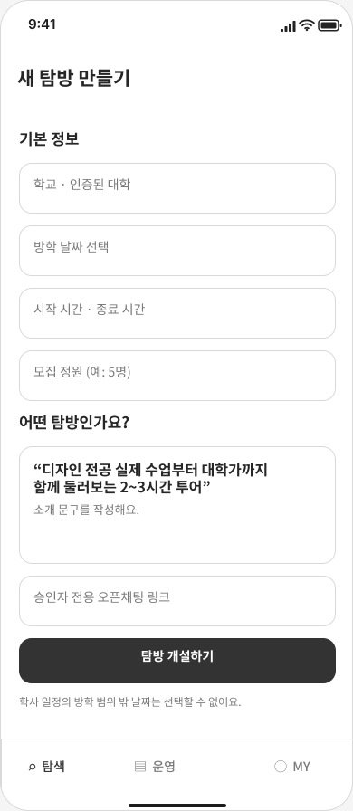

레이어 구조

- **Top bar**
  - "새 탐방 만들기"
- **Main content**
  - "기본 정보"
  - [Field / Input / 350×56]
  - [Field / Input / 350×56]
  - [Field / Input / 350×56]
  - [Field / Input / 350×56]
  - "어떤 탐방인가요?"
  - **Tour intro**
    - "“디자인 전공 실제 수업부터 대학가까지 함께 둘"
    - "소개 문구를 작성해요."
  - [Field / Input / 350×56]
  - [Button / Primary / 350×50]
  - "학사 일정의 방학 범위 밖 날짜는 선택할 수 없"
- **Bottom Navigation**
  - [Navigation / Student Bottom]

### `guide-s03` SCREEN 03 • 신청자 관리

- 기능/플로우: A-02 · A-04 · T-05
- 보드 라벨: 03 / 신청자 관리
- 피그잼 노드: [1:746](https://www.figma.com/board/VeUqh8ihXdgzUkpMTaPXsr/?node-id=1-746)
- 이미지: 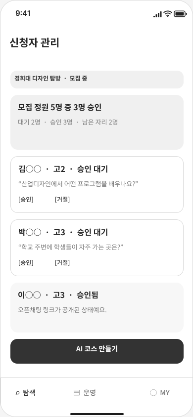

레이어 구조

- **Top bar**
  - "신청자 관리"
- **Main content**
  - **Chip • 경희대 디자인 탐방 · 모집 중**
    - "경희대 디자인 탐방 · 모집 중"
  - **Applicants status**
    - "모집 정원 5명 중 3명 승인"
    - "대기 2명 · 승인 3명 · 남은 자리"
  - **Applicant 1**
    - "김○○ · 고2 · 승인 대기"
    - "“산업디자인에서 어떤 프로그램을 배우나요?”"
    - "[승인] [거절]"
  - **Applicant 2**
    - "박○○ · 고3 · 승인 대기"
    - "“학교 주변에 학생들이 자주 가는 곳은?”"
    - "[승인] [거절]"
  - **Applicant 3**
    - "이○○ · 고3 · 승인됨"
    - "오픈채팅 링크가 공개된 상태예요."
  - [Button / Primary / 350×50]
- **Bottom Navigation**
  - [Navigation / Student Bottom]

### `guide-s04` SCREEN 04 • AI 추천 코스 생성

- 기능/플로우: C-01 · D-03 (정의 확인 필요)
- 보드 라벨: 04 / AI 추천 코스 생성
- 피그잼 노드: [1:772](https://www.figma.com/board/VeUqh8ihXdgzUkpMTaPXsr/?node-id=1-772)
- 이미지: 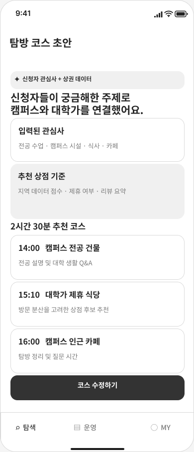

레이어 구조

- **Top bar**
  - "탐방 코스 초안"
- **Main content**
  - **Chip • ✦ 신청자 관심사 + 상권 데이터**
    - "✦ 신청자 관심사 + 상권 데이터"
  - "신청자들이 궁금해한 주제로 캠퍼스와 대학가를 연"
  - **AI signals**
    - "입력된 관심사"
    - "전공 수업 · 캠퍼스 시설 · 식사 · 카페"
  - **Commercial score**
    - "추천 상점 기준"
    - "지역 데이터 점수 · 제휴 여부 · 리뷰 요약"
  - "2시간 30분 추천 코스"
  - **Place 1**
    - "14:00 캠퍼스 전공 건물"
    - "전공 설명 및 대학 생활 Q&A"
  - **Place 2**
    - "15:10 대학가 제휴 식당"
    - "방문 분산을 고려한 상점 후보 추천"
  - **Place 3**
    - "16:00 캠퍼스 인근 카페"
    - "탐방 정리 및 질문 시간"
  - [Button / Primary / 350×50]
- **Bottom Navigation**
  - [Navigation / Student Bottom]

### `guide-s05` SCREEN 05 • 코스 편집 · 상점 교체

- 기능/플로우: C-02 · S-02
- 보드 라벨: 05 / 코스 편집 · 상점 교체
- 피그잼 노드: [1:801](https://www.figma.com/board/VeUqh8ihXdgzUkpMTaPXsr/?node-id=1-801)
- 이미지: 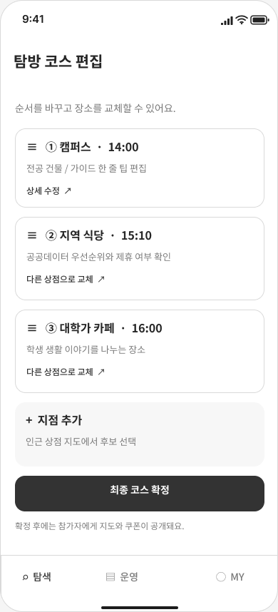

레이어 구조

- **Top bar**
  - "탐방 코스 편집"
- **Main content**
  - "순서를 바꾸고 장소를 교체할 수 있어요."
  - **Reorder item 1**
    - "≡ ① 캠퍼스 · 14:00"
    - "전공 건물 / 가이드 한 줄 팁 편집"
    - "상세 수정 ↗"
  - **Reorder item 2**
    - "≡ ② 지역 식당 · 15:10"
    - "공공데이터 우선순위와 제휴 여부 확인"
    - "다른 상점으로 교체 ↗"
  - **Reorder item 3**
    - "≡ ③ 대학가 카페 · 16:00"
    - "학생 생활 이야기를 나누는 장소"
    - "다른 상점으로 교체 ↗"
  - **Add item**
    - "+ 지점 추가"
    - "인근 상점 지도에서 후보 선택"
  - [Button / Primary / 350×50]
  - "확정 후에는 참가자에게 지도와 쿠폰이 공개돼요."
- **Bottom Navigation**
  - [Navigation / Student Bottom]

### `guide-s06` SCREEN 06 • 코스 확정 · 쿠폰 발급

- 기능/플로우: C-03 · S-04
- 보드 라벨: 06 / 코스 확정 · 쿠폰 발급
- 피그잼 노드: [1:828](https://www.figma.com/board/VeUqh8ihXdgzUkpMTaPXsr/?node-id=1-828)
- 이미지: 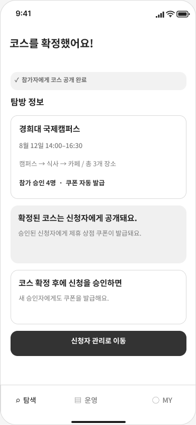

레이어 구조

- **Top bar**
  - "코스를 확정했어요!"
- **Main content**
  - **Chip • ✓ 참가자에게 코스 공개 완료**
    - "✓ 참가자에게 코스 공개 완료"
  - "탐방 정보"
  - [Card / Tour Preview]
  - **Confirmation**
    - "확정된 코스는 신청자에게 공개돼요."
    - "승인된 신청자에게 제휴 상점 쿠폰이 발급돼요."
  - **Late approval**
    - "코스 확정 후에 신청을 승인하면"
    - "새 승인자에게도 쿠폰을 발급해요."
  - [Button / Primary / 350×50]
- **Bottom Navigation**
  - [Navigation / Student Bottom]

### `guide-s07` SCREEN 07 • 탐방 종료 · 완료

- 기능/플로우: T-06 · R-01
- 보드 라벨: 07 / 탐방 종료 · 완료
- 피그잼 노드: [1:848](https://www.figma.com/board/VeUqh8ihXdgzUkpMTaPXsr/?node-id=1-848)
- 이미지: 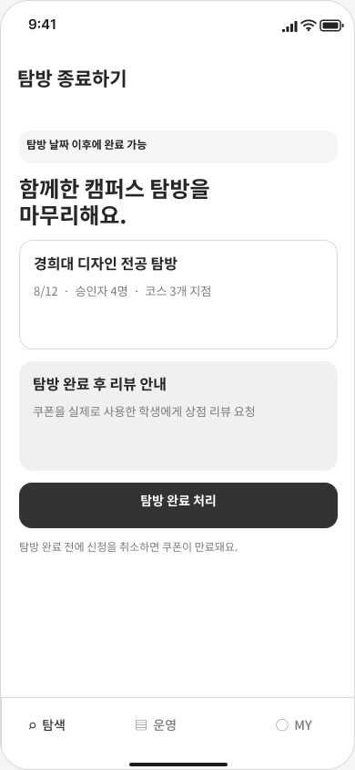

레이어 구조

- **Top bar**
  - "탐방 종료하기"
- **Main content**
  - **Chip • 탐방 날짜 이후에 완료 가능**
    - "탐방 날짜 이후에 완료 가능"
  - "함께한 캠퍼스 탐방을 마무리해요."
  - **Complete summary**
    - "경희대 디자인 전공 탐방"
    - "8/12 · 승인자 4명 · 코스 3개"
  - **Review trigger**
    - "탐방 완료 후 리뷰 안내"
    - "쿠폰을 실제로 사용한 학생에게 상점 리뷰 요청"
  - [Button / Primary / 350×50]
  - "탐방 완료 전에 신청을 취소하면 쿠폰이 만료돼요"
- **Bottom Navigation**
  - [Navigation / Student Bottom]

### `guide-a01` ADD 01 • 대학생 재학 인증

- 기능/플로우: U-05 / F-C1
- 보드 라벨: 01 / 대학생 재학 인증
- 피그잼 노드: [1:870](https://www.figma.com/board/VeUqh8ihXdgzUkpMTaPXsr/?node-id=1-870)
- 이미지: 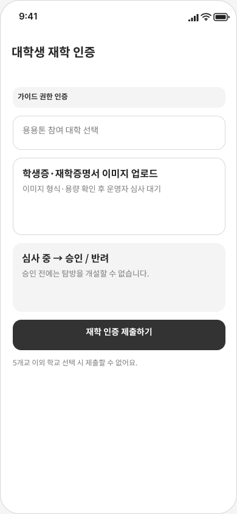

레이어 구조

- **Top bar**
  - "대학생 재학 인증"
- **Main content**
  - **Status / 가이드 권한 인증**
    - "가이드 권한 인증"
  - [input]
  - **Upload**
    - "학생증·재학증명서 이미지 업로드"
    - "이미지 형식·용량 확인 후 운영자 심사"
  - **Result**
    - "심사 중 → 승인 / 반려"
    - "승인 전에는 탐방을 개설할 수 없습니다."
  - [primary]
  - "5개교 이외 학교 선택 시 제출할 수 없"

### `guide-a02` ADD 02 • 내가 개설한 탐방

- 기능/플로우: T-04 · T-05 / F-G1
- 보드 라벨: 02 / 내가 개설한 탐방
- 피그잼 노드: [1:888](https://www.figma.com/board/VeUqh8ihXdgzUkpMTaPXsr/?node-id=1-888)
- 이미지: 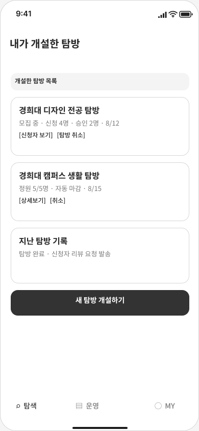

레이어 구조

- **Top bar**
  - "내가 개설한 탐방"
- **Main content**
  - **Status / 개설한 탐방 목록**
    - "개설한 탐방 목록"
  - **Tour A**
    - "경희대 디자인 전공 탐방"
    - "모집 중 · 신청 4명 · 승인 2명 ·"
    - "[신청자 보기] [탐방 취소]"
  - **Tour B**
    - "경희대 캠퍼스 생활 탐방"
    - "정원 5/5명 · 자동 마감 · 8/15"
    - "[상세보기] [취소]"
  - **Tour C**
    - "지난 탐방 기록"
    - "탐방 완료 · 신청자 리뷰 요청 발송"
  - [primary]
- **Bottom Navigation**
  - [nav]

### `guide-a03` ADD 03 • 주변 상점 교체

- 기능/플로우: C-02 · S-02 / F-G2
- 보드 라벨: 03 / 주변 상점 교체
- 피그잼 노드: [1:911](https://www.figma.com/board/VeUqh8ihXdgzUkpMTaPXsr/?node-id=1-911)
- 이미지: 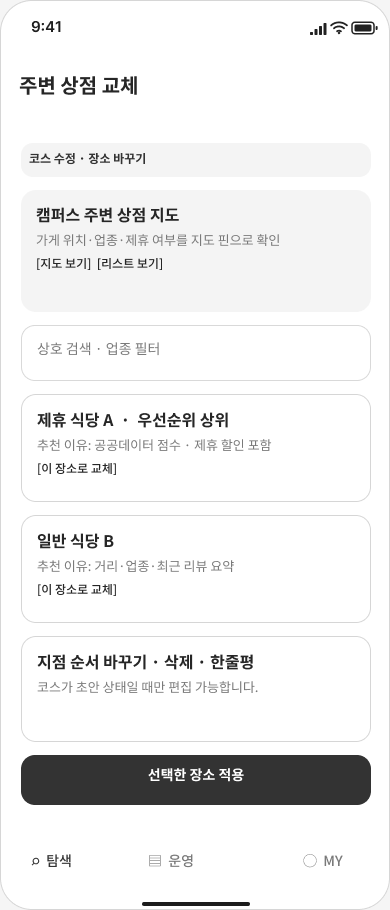

레이어 구조

- **Top bar**
  - "주변 상점 교체"
- **Main content**
  - **Status / 코스 수정 · 장소 바꾸기**
    - "코스 수정 · 장소 바꾸기"
  - **Map selection**
    - "캠퍼스 주변 상점 지도"
    - "가게 위치·업종·제휴 여부를 지도 핀으로"
    - "[지도 보기] [리스트 보기]"
  - [input]
  - **Candidate 1**
    - "제휴 식당 A · 우선순위 상위"
    - "추천 이유: 공공데이터 점수 · 제휴 할"
    - "[이 장소로 교체]"
  - **Candidate 2**
    - "일반 식당 B"
    - "추천 이유: 거리·업종·최근 리뷰 요약"
    - "[이 장소로 교체]"
  - **Course actions**
    - "지점 순서 바꾸기 · 삭제 · 한줄평"
    - "코스가 초안 상태일 때만 편집 가능합니다"
  - [primary]
- **Bottom Navigation**
  - [nav]

### `guide-a04` ADD 04 • 탐방 취소 확인

- 기능/플로우: T-05 / F-G2 · 예외
- 보드 라벨: 04 / 탐방 취소 확인
- 피그잼 노드: [1:939](https://www.figma.com/board/VeUqh8ihXdgzUkpMTaPXsr/?node-id=1-939)
- 이미지: 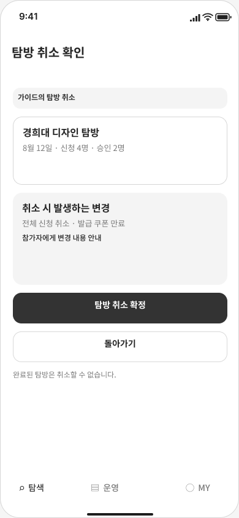

레이어 구조

- **Top bar**
  - "탐방 취소 확인"
- **Main content**
  - **Status / 가이드의 탐방 취소**
    - "가이드의 탐방 취소"
  - **Selected**
    - "경희대 디자인 탐방"
    - "8월 12일 · 신청 4명 · 승인 2명"
  - **Warning**
    - "취소 시 발생하는 변경"
    - "전체 신청 취소 · 발급 쿠폰 만료"
    - "참가자에게 변경 내용 안내"
  - [primary]
  - [secondary]
  - "완료된 탐방은 취소할 수 없습니다."
- **Bottom Navigation**
  - [nav]

## 사장님 · 운영자

### `owner-s01` SCREEN 01 • 사업자 인증

- 기능/플로우: U-07 · S-01
- 보드 라벨: 01 / 사업자 인증
- 피그잼 노드: [1:1170](https://www.figma.com/board/VeUqh8ihXdgzUkpMTaPXsr/?node-id=1-1170)
- 이미지: 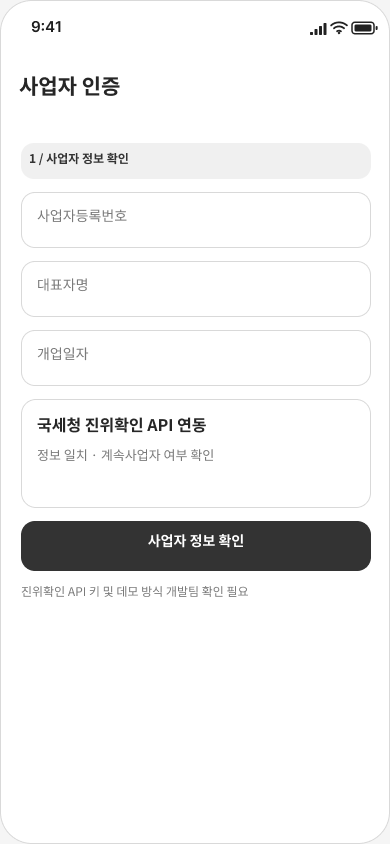

레이어 구조

- **Top bar**
  - "사업자 인증"
- **Main content**
  - **Chip • 1 / 사업자 정보 확인**
    - "1 / 사업자 정보 확인"
  - [Field / Input / 350×56]
  - [Field / Input / 350×56]
  - [Field / Input / 350×56]
  - **Verification**
    - "국세청 진위확인 API 연동"
    - "정보 일치 · 계속사업자 여부 확인"
  - [Button / Primary / 350×50]
  - "진위확인 API 키 및 데모 방식 개발팀 확인"

### `owner-s02` SCREEN 02 • 내 가게 · 제휴 할인

- 기능/플로우: S-01 · S-03
- 보드 라벨: 02 / 내 가게 · 제휴 할인
- 피그잼 노드: [1:1187](https://www.figma.com/board/VeUqh8ihXdgzUkpMTaPXsr/?node-id=1-1187)
- 이미지: 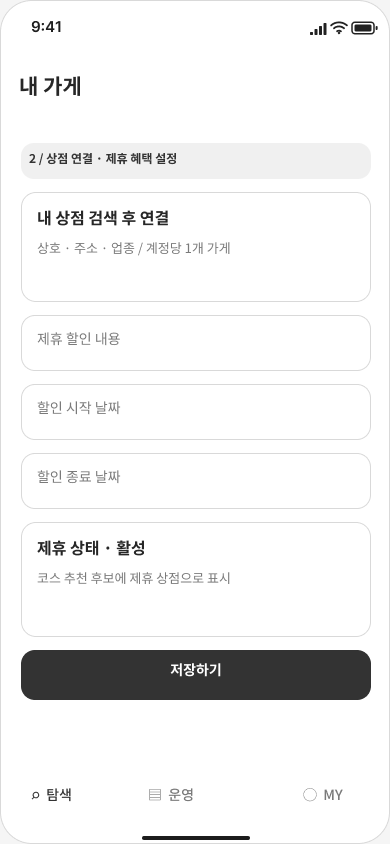

레이어 구조

- **Top bar**
  - "내 가게"
- **Main content**
  - **Chip • 2 / 상점 연결 · 제휴 혜택 설정**
    - "2 / 상점 연결 · 제휴 혜택 설정"
  - **Shop select**
    - "내 상점 검색 후 연결"
    - "상호 · 주소 · 업종 / 계정당 1개 가게"
  - [Field / Input / 350×56]
  - [Field / Input / 350×56]
  - [Field / Input / 350×56]
  - **Partnership status**
    - "제휴 상태 · 활성"
    - "코스 추천 후보에 제휴 상점으로 표시"
  - [Button / Primary / 350×50]
- **Bottom Navigation**
  - [Navigation / Student Bottom]

### `owner-s03` SCREEN 03 • 쿠폰 사용 처리

- 기능/플로우: S-06
- 보드 라벨: 03 / 쿠폰 사용 처리
- 피그잼 노드: [1:1208](https://www.figma.com/board/VeUqh8ihXdgzUkpMTaPXsr/?node-id=1-1208)
- 이미지: 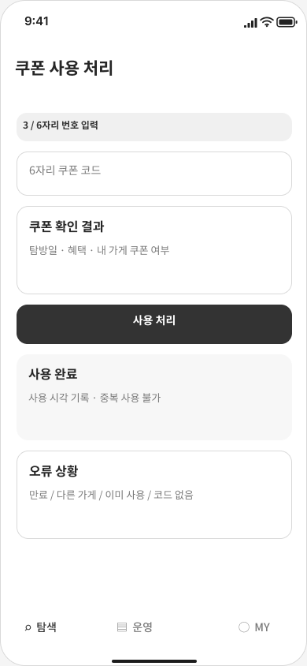

레이어 구조

- **Top bar**
  - "쿠폰 사용 처리"
- **Main content**
  - **Chip • 3 / 6자리 번호 입력**
    - "3 / 6자리 번호 입력"
  - [Field / Input / 350×56]
  - **Coupon info**
    - "쿠폰 확인 결과"
    - "탐방일 · 혜택 · 내 가게 쿠폰 여부"
  - [Button / Primary / 350×50]
  - **State : complete**
    - "사용 완료"
    - "사용 시각 기록 · 중복 사용 불가"
  - **State : error**
    - "오류 상황"
    - "만료 / 다른 가게 / 이미 사용 / 코드 없음"
- **Bottom Navigation**
  - [Navigation / Student Bottom]

### `owner-s04` SCREEN 04 • 방문 · 리뷰 리포트

- 기능/플로우: S-07 · R-02 · R-03
- 보드 라벨: 04 / 방문 · 리뷰 리포트
- 피그잼 노드: [1:1230](https://www.figma.com/board/VeUqh8ihXdgzUkpMTaPXsr/?node-id=1-1230)
- 이미지: 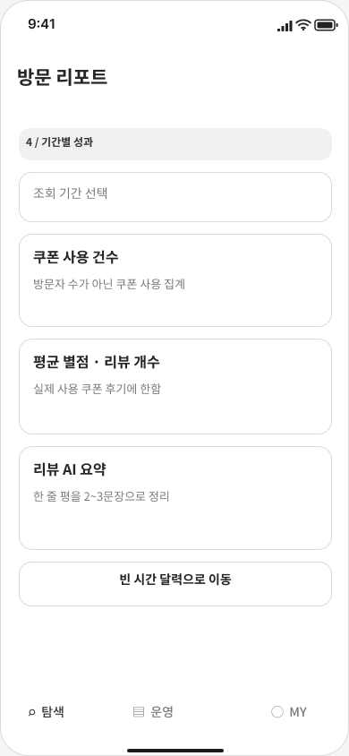

레이어 구조

- **Top bar**
  - "방문 리포트"
- **Main content**
  - **Chip • 4 / 기간별 성과**
    - "4 / 기간별 성과"
  - [Field / Input / 350×56]
  - **Metric: visit**
    - "쿠폰 사용 건수"
    - "방문자 수가 아닌 쿠폰 사용 집계"
  - **Metric: review**
    - "평균 별점 · 리뷰 개수"
    - "실제 사용 쿠폰 후기에 한함"
  - **AI review**
    - "리뷰 AI 요약"
    - "한 줄 평을 2~3문장으로 정리"
  - [Button / Secondary / 350×50]
- **Bottom Navigation**
  - [Navigation / Student Bottom]

### `owner-s05` SCREEN 05 • 빈 시간 달력

- 기능/플로우: S-03 · D-02 검토 / FigJam 미표시
- 보드 라벨: 05 / 빈 시간 달력
- 피그잼 노드: [1:1252](https://www.figma.com/board/VeUqh8ihXdgzUkpMTaPXsr/?node-id=1-1252)
- 이미지: 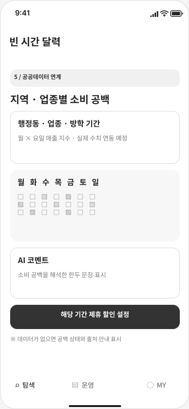

레이어 구조

- **Top bar**
  - "빈 시간 달력"
- **Main content**
  - **Chip • 5 / 공공데이터 연계**
    - "5 / 공공데이터 연계"
  - "지역 · 업종별 소비 공백"
  - **Source**
    - "행정동 · 업종 · 방학 기간"
    - "월 × 요일 매출 지수 · 실제 수치 연동 예정"
  - **Calendar placeholder**
    - "월 화 수 목 금 토 일"
    - "□ □ ▧ □ ▧ □"
  - **AI Insight**
    - "AI 코멘트"
    - "소비 공백을 해석한 한두 문장 표시"
  - [Button / Primary / 350×50]
  - "※ 데이터가 없으면 공백 상태와 출처 안내 표시"
- **Bottom Navigation**
  - [Navigation / Student Bottom]

### `owner-s06` SCREEN 06 • 운영자 인증 심사

- 기능/플로우: U-08 · F-A1
- 보드 라벨: 06 / 운영자 인증 심사
- 피그잼 노드: [1:1275](https://www.figma.com/board/VeUqh8ihXdgzUkpMTaPXsr/?node-id=1-1275)
- 이미지: 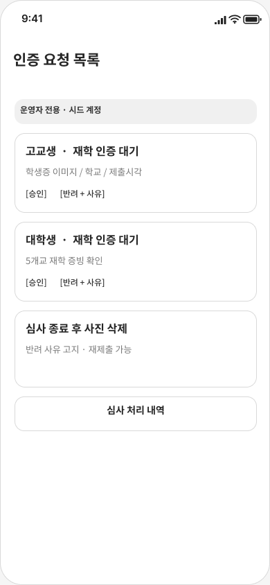

레이어 구조

- **Top bar**
  - "인증 요청 목록"
- **Main content**
  - **Chip • 운영자 전용 · 시드 계정**
    - "운영자 전용 · 시드 계정"
  - **Student proof 1**
    - "고교생 · 재학 인증 대기"
    - "학생증 이미지 / 학교 / 제출시각"
    - "[승인] [반려 + 사유]"
  - **Student proof 2**
    - "대학생 · 재학 인증 대기"
    - "5개교 재학 증빙 확인"
    - "[승인] [반려 + 사유]"
  - **Privacy rule**
    - "심사 종료 후 사진 삭제"
    - "반려 사유 고지 · 재제출 가능"
  - [Button / Secondary / 350×50]

### `owner-a01` ADD 01 • 가게 후보 선택·직접 등록

- 기능/플로우: S-01 / F-O1
- 보드 라벨: 01 / 가게 후보 선택·직접 등록
- 피그잼 노드: [1:1298](https://www.figma.com/board/VeUqh8ihXdgzUkpMTaPXsr/?node-id=1-1298)
- 이미지: 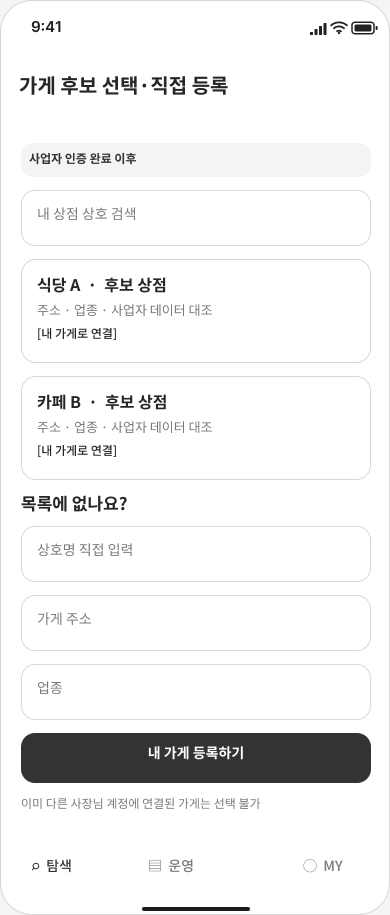

레이어 구조

- **Top bar**
  - "가게 후보 선택·직접 등록"
- **Main content**
  - **Status / 사업자 인증 완료 이후**
    - "사업자 인증 완료 이후"
  - [input]
  - **Candidate 1**
    - "식당 A · 후보 상점"
    - "주소 · 업종 · 사업자 데이터 대조"
    - "[내 가게로 연결]"
  - **Candidate 2**
    - "카페 B · 후보 상점"
    - "주소 · 업종 · 사업자 데이터 대조"
    - "[내 가게로 연결]"
  - "목록에 없나요?"
  - [input]
  - [input]
  - [input]
  - [primary]
  - "이미 다른 사장님 계정에 연결된 가게는"
- **Bottom Navigation**
  - [nav]

### `owner-a02` ADD 02 • 학생증 상세 심사·반려

- 기능/플로우: U-08 / F-A1
- 보드 라벨: 02 / 학생증 상세 심사·반려
- 피그잼 노드: [1:1324](https://www.figma.com/board/VeUqh8ihXdgzUkpMTaPXsr/?node-id=1-1324)
- 이미지: 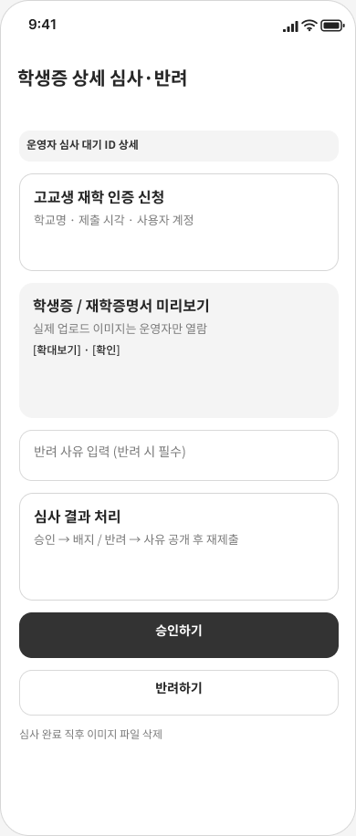

레이어 구조

- **Top bar**
  - "학생증 상세 심사·반려"
- **Main content**
  - **Status / 운영자 심사 대기 ID 상세**
    - "운영자 심사 대기 ID 상세"
  - **Request**
    - "고교생 재학 인증 신청"
    - "학교명 · 제출 시각 · 사용자 계정"
  - **Document thumbnail**
    - "학생증 / 재학증명서 미리보기"
    - "실제 업로드 이미지는 운영자만 열람"
    - "[확대보기] · [확인]"
  - [input]
  - **Process**
    - "심사 결과 처리"
    - "승인 → 배지 / 반려 → 사유 공개 후"
  - [primary]
  - [secondary]
  - "심사 완료 직후 이미지 파일 삭제"

### `owner-a03` ADD 03 • 쿠폰·리포트 예외 상태

- 기능/플로우: S-06 · S-07 / 상태 UI
- 보드 라벨: 03 / 쿠폰·리포트 예외 상태
- 피그잼 노드: [1:1347](https://www.figma.com/board/VeUqh8ihXdgzUkpMTaPXsr/?node-id=1-1347)
- 이미지: 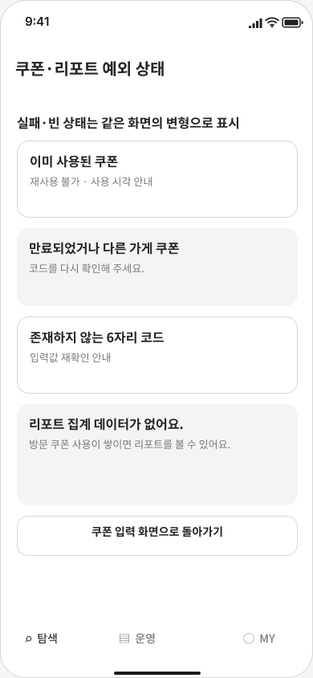

레이어 구조

- **Top bar**
  - "쿠폰·리포트 예외 상태"
- **Main content**
  - "실패·빈 상태는 같은 화면의 변형으로 표"
  - **Coupon error A**
    - "이미 사용된 쿠폰"
    - "재사용 불가 · 사용 시각 안내"
  - **Coupon error B**
    - "만료되었거나 다른 가게 쿠폰"
    - "코드를 다시 확인해 주세요."
  - **Coupon error C**
    - "존재하지 않는 6자리 코드"
    - "입력값 재확인 안내"
  - **Empty data**
    - "리포트 집계 데이터가 없어요."
    - "방문 쿠폰 사용이 쌓이면 리포트를 볼 수"
  - [secondary]
- **Bottom Navigation**
  - [nav]

